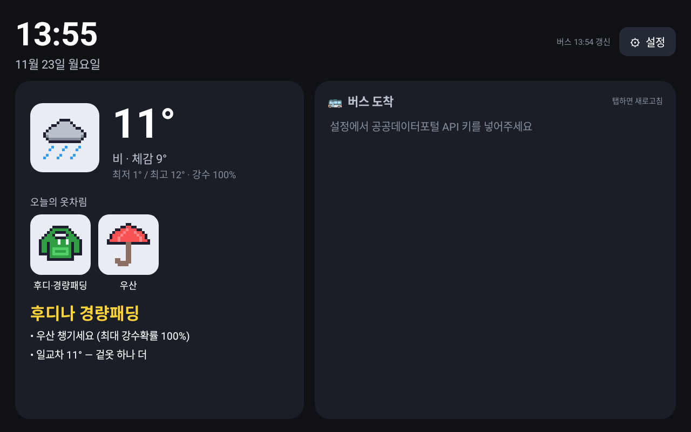

# 아침보드 (macOS)

안드로이드 **아침보드** 위젯 앱의 macOS 데스크톱 포팅.
날씨·옷차림·버스 도착 정보를 보여주는, 바탕화면에 띄워두는 데스크 보드.

Android 앱(Kotlin)의 **날씨·버스·파싱·데이터 로직을 그대로 재사용**하고, UI만 **Compose for Desktop**으로 다시 그렸다.



## 특징
- 큰 시계 + 한글 날짜
- 날씨(기온·체감·최저/최고·강수) + 날씨별 **픽셀아트 배경 애니메이션**(맑음/밤하늘/비/눈/안개/뇌우)
- 체감온도 기준 **오늘의 옷차림** 추천 + 주간 날씨
- 서울/경기 **버스 실시간 도착** 카운트다운
- **항상 위**(📌) 토글 — 바탕화면에 위젯처럼 떠 있음
- 날씨는 [Open-Meteo](https://open-meteo.com)(무료·키 불필요), 버스는 공공데이터포털 인증키 사용

## 기술 스택
- Kotlin 2.1 + Compose Multiplatform 1.7.3 (Desktop)
- JDK 21 (jpackage 로 `.app`/`.dmg` 번들 + JRE 포함)
- 로직 재사용: `Weather.kt`(Open-Meteo), `Bus.kt`(서울/경기, XML→StAX), `Board.kt`, `Data.kt`, `Pixel.kt`
- 설정 저장: `~/Library/Application Support/MorningBoard/prefs.json`

## 빌드

JDK 21 필요 (예: Android Studio 번들 JBR 대신 jpackage 포함된 배포판):
```bash
export JAVA_HOME=/opt/homebrew/opt/openjdk@21/libexec/openjdk.jdk/Contents/Home

./gradlew run          # 바로 실행
./gradlew packageDmg   # 서명된 .dmg 생성 → build/compose/binaries/main/dmg/
```

## 배포(서명 + 공증)
`build.gradle.kts` 의 `macOS.signing` 블록에서 Developer ID 로 서명 + 하드닝 런타임이 자동 적용된다.
공증은:
```bash
# 최초 1회: 앱 암호를 키체인에 저장
xcrun notarytool store-credentials "morningboard" \
  --apple-id "<apple-id>" --team-id 469F7JUL9Q --password "<앱-암호>"

./notarize.sh   # 빌드 → 공증 제출 → staple
```

## macOS 관련 메모
- 투명 undecorated 창은 Metal 에서 크래시(exit 133), SOFTWARE 렌더에선 깜박여서 **일반 창 + Metal**(기본)로 간다.
- jlink 런타임에 `jdk.localedata`(한글 요일), `jdk.crypto.ec`(HTTPS)를 포함해야 한다 → `build.gradle.kts` 의 `modules(...)`.
